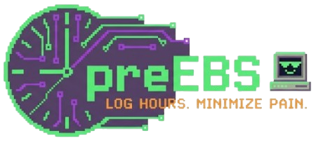

# PreEBS



Enter Monday–Friday hours in PreEBS, export JSON, then import that JSON into EBS with the Chrome or Firefox extension.

The desktop app and the `preebs` CLI share one SQLite database. Nothing has to be running for the CLI to work.

## Desktop app

```bash
cd crates/preebs-app
npm install
npm run tauri dev
```

Install the unsigned macOS app and the `preebs` CLI with Homebrew:

```bash
brew tap Bethamil/preebs
brew install --cask preebs
```

The cask installs `PreEBS.app` and links the `preebs` binary that is bundled inside the app. See [docs/releasing.md](docs/releasing.md) for tags and the tap.

A local bundle (macOS `.app` / `.dmg`, or Linux `.deb`):

```bash
cd crates/preebs-app
npm install
npx tauri build
```

PreEBS ships for macOS and Linux. The macOS bundle id is `com.preebs.desktop`, the minimum system version is 11, and CI leaves the app unsigned (`signingIdentity` is `-`). Set a real Apple signing identity when you are ready to sign; the UI does not need another build for that.

The database lives in the platform app-support directory:

- macOS: `~/Library/Application Support/PreEBS/preebs.sqlite`
- Linux: `$XDG_DATA_HOME/PreEBS/preebs.sqlite` or `~/.local/share/PreEBS/preebs.sqlite`

`--db` / `PREEBS_DB_PATH` and `--data-dir` / `PREEBS_DATA_DIR` override that. The app follows `PREEBS_DB_PATH` and `PREEBS_DATA_DIR` the same way.

The app UI is Dutch: Uren, Weken, and Instellingen. Keyboard: arrow keys move between hour cells, Enter moves down, Tab follows the page. Cmd/Ctrl-K opens the command palette. Cmd/Ctrl-1/2/3/4 switch Uren, Weken, Instellingen, and Export. Cmd/Ctrl-Left/Right change week. Cmd/Ctrl-E opens export. Cmd/Ctrl-Shift-C copies the previous week. The same actions are on the native menu.

## CLI

```bash
cargo build --release -p preebs-cli
./target/release/preebs config show
./target/release/preebs book --date 2026-09-25 --project PROJECT_ID --task TASK_ID --hours 7.5
./target/release/preebs export --date 2026-09-25
```

`book` sets the cell. It does not add, so retrying a command is safe. Hours are 0 through 24 in steps of 0.5 (`7.5` and `7,5`). The hour type can be omitted when the task has exactly one. A booking past the daily maximum is rejected and writes nothing.

`export` writes the JSON the extensions already import. The default file is `./preebs-WEEK-MONDAY.json`. Existing files are left untouched.

Import a database from the old Electron app once:

```bash
preebs migrate --from ~/Library/Application\ Support/PreEBS/preebs-db.json
```

Without `--from`, `migrate` looks in the old Electron locations and `./data/preebs-db.json`. It is safe to run again. Config is replaced, weeks in the file are upserted, and weeks that exist only in SQLite stay. The JSON file is not deleted.

Every command accepts `--json`. The shapes and exit codes are in [docs/cli.md](docs/cli.md). Agents should follow [skills/preebs/SKILL.md](skills/preebs/SKILL.md).

```bash
npx skills add Bethamil/preEBS --skill preebs
```

## Config

The config screen edits projects, tasks, hour types, the default hour type for new tasks, and the five daily maxima. Config files are still `preebs-config` version 1. Export and import are on that screen and on the CLI (`preebs config export`, `preebs config import`). Old files without `defaultHourTypeName` import as `Straight Time`.

## Browser extensions

These folders are unchanged:

- `chrome-extension/preebs-ebs-importer`
- `firefox-extension/preebs-ebs-importer`

Chrome: open `chrome://extensions`, enable Developer mode, Load unpacked, and choose the Chrome folder.

Firefox: open `about:debugging#/runtime/this-firefox`, Load Temporary Add-on, and choose `firefox-extension/preebs-ebs-importer/manifest.json`.

On the EBS timecard page, open the extension, paste the exported JSON, and run the import. Then review and save in EBS.

## Development

```bash
cargo fmt --check
cargo clippy --workspace --all-targets -- -D warnings
cargo test --workspace
```

Rust 1.90 (see `rust-toolchain.toml`). On Linux, install WebKitGTK 4.1 before building the app: `libwebkit2gtk-4.1-dev`, `libgtk-3-dev`, `libayatana-appindicator3-dev`, `librsvg2-dev`, `patchelf`.

The previous Next.js and Electron app is in `legacy/`. Differences from that version are listed in [docs/rust-plan.md](docs/rust-plan.md).
